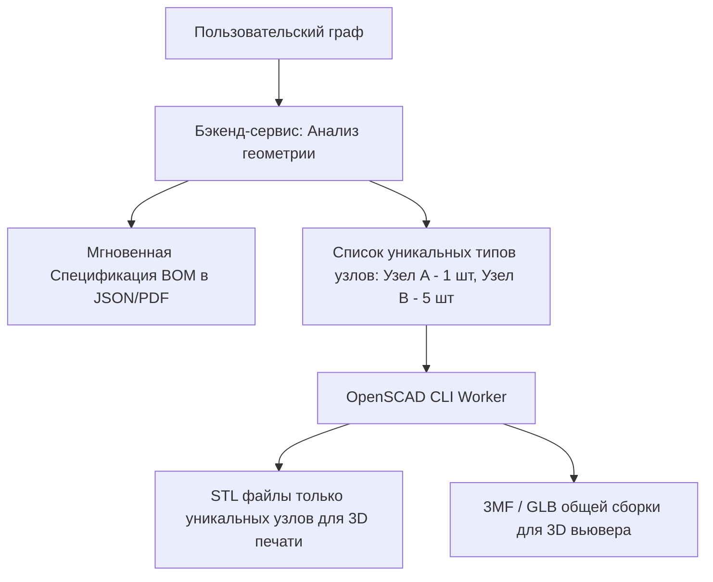

Я хочу к ним прикрутить Дополнительный функционал к модулю /graph3d который будет создавать конструкции из разных типов узлов - который создаёт 3D модели узов, спецификации.
 наработки в for_3d_graph.scad. Как считаешь, мне этот файл разделить на файлы, каждый со своим типа узла. Чтобы пользователь применителоьно к графу мог выбрать и получить 3д модели или модели узлов, для печати и спецификацию? Как вообще лучше лаконично это сделать?


Да, разделять этот монолит for_3d_graph.scad **однозначно нужно**. 

Если оставить код в одном файле и копировать его под каждый новый тип узла, вы получите дублирование математики (кластеризация, расчёт углов, повороты матриц), в которой любые правки придётся синхронизировать между десятками файлов.

Ниже описана лаконичная и масштабируемая архитектура, адаптированная под работу в веб-сервисе.

---

### Главная проблема текущего монолита для сервиса

В вашем файле сейчас перемешаны **4 разные зоны ответственности**:
1. **Данные графа** (`NODES`, `EDGES`) — должны динамически приходить из вашего сервиса.
2. **Топологическая математика** (расчёт матриц поворота `orient_up`, углы между лучами, дедупликация одинаковых узлов).
3. **Конструктив/тип узла** (профили сечений, посадочные гильзы, толщины стенок, крестовины/трубки).
4. **Формирование спецификации (BOM)** — сейчас это вывод в консоль через `echo()`.

---

### Рекомендуемая архитектура разделения

Разделите логику по принципу **«Ядро + Плагины типов узлов + Данные»**:

```plaintext
cad-engine/
│
├── core/
│   ├── math.scad           # Векторная математика, orient_up(), расчет углов
│   └── clustering.scad     # Сращивание близких вершин (если нужно на уровне SCAD)
│
├── node_types/             # Каталог узлов (каждый файл — отдельный тип)
│   ├── cross_sleeve.scad   # Крестовой вал (текущий cross)
│   ├── round_tube.scad     # Под круглые трубы/шканты
│   ├── flat_slat.scad      # Под плоские рейки/палочки мороженого
│   └── bolted_plate.scad   # Металлический лепесток / на болтах
│
├── generators/
│   ├── render_single.scad  # Генерация одного STL узла по сигнатуре
│   └── render_assembly.scad# Полная сборка конструкции для превью
│
└── jobs/ (динамические)
    └── input_data.scad     # Генерируется вашим бэкендом на лету
```

---

### Контракт (интерфейс) для типа узла

Чтобы любой тип узла подключался лаконично (паттерн «Стратегия»), каждый файл из папки `node_types/` должен реализовывать **одинаковый интерфейс модулей**.

Например, файл `node_types/round_tube.scad`:
```openscad
// Входные параметры типа узла
tube_d    = 10;
insert_len = 15;
wall_th   = 2.0;

// Обязательный модуль луча
module node_arm_outer() {
    cylinder(d = tube_d + wall_th*2, h = insert_len);
}

module node_arm_slot() {
    translate([0, 0, wall_th])
        cylinder(d = tube_d, h = insert_len + 1);
}

// Профиль для визуализации в общей сборке
module stick_geometry(length) {
    cylinder(d = tube_d, h = length, center = true);
}
```

А общее ядро собирает узел через `hull()` и разносит лучи по векторам:
```openscad
use <core/math.scad>

module generate_node(arms_directions) {
    difference() {
        union() {
            hull() for (d = arms_directions) orient_up(d) node_arm_outer();
            for (d = arms_directions) orient_up(d) node_arm_outer();
        }
        for (d = arms_directions) orient_up(d) node_arm_slot();
    }
}
```

---

### Архитектурный совет: где считать спецификацию (BOM)?

Поскольку у вас уже есть сервис графовых структур (бэкенд на Python / Node.js / Go / etc.):

1. **Не считайте BOM и дедупликацию внутри OpenSCAD через `echo`:**
   - Парсить текстовый stdout из OpenSCAD в бэкенде — хрупко и медленно.
   - Математика графов (углы между рёбрами $\arccos(\frac{\vec{a} \cdot \vec{b}}{|\vec{a}| |\vec{b}|})$, длины палочек, группировка одинаковых узлов) на бэкенде считается за **1–2 миллисекунды**, в то время как запуск OpenSCAD занимает секунды.

2. **Оптимальный пайплайн сервиса:**



### Преимущества такого подхода:
* **Экономия ресурсов печати/рендера:** Если в куполе 100 вершин, но геометрически уникальных узлов всего 2 (например, 5-лучевой для вершины и 6-лучевой для пояса), сервис отправляет на рендеринг **только 2 маленьких STL-файла**, а не пересчитывает весь каркас целиком.
* **Лёгкое добавление типов узлов:** Хотите добавить узел под профильную трубу $20 \times 20$ или шарнир? Вы просто добавляете один `.scad`-файл с геометрией посадочного места, вся остальная система (граф, углы, раскрой) остаётся нетронутой.